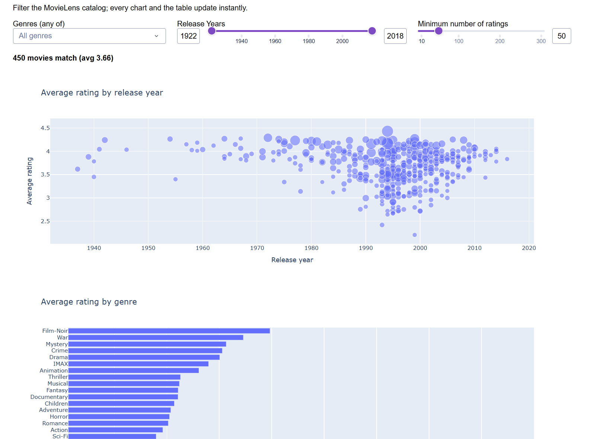
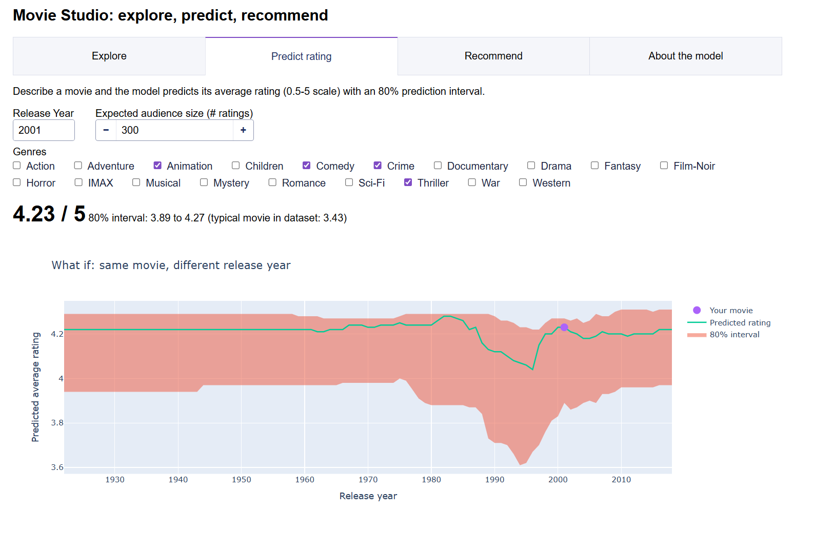
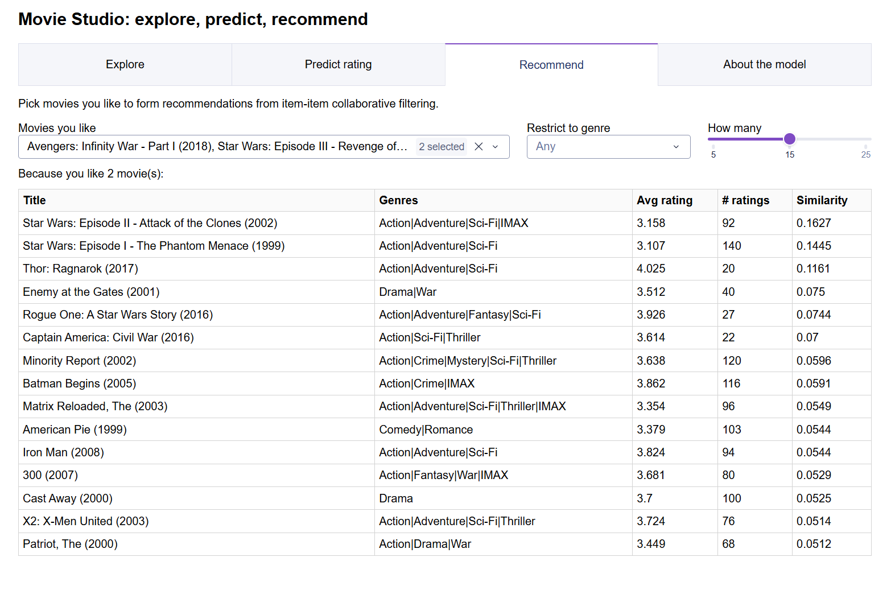

# 🎬 Movie Studio: Explore, Predict, Recommend

[](https://github.com/YOUR-USERNAME/movie-studio/actions)


An end-to-end data product on the real [MovieLens "latest-small"](https://grouplens.org/datasets/movielens/latest/) dataset (GroupLens Research: ~100,000 ratings, ~9,700 movies, 600+ users). It covers the full workflow: data ingestion → feature engineering → modeling with calibrated uncertainty → honest evaluation → two deployable interfaces.

**[Live demo](https://movie-studio-10il.onrender.com)** · **[Project page](https://jacobconner069.github.io/movie-studio/)** · **[API docs](#rest-api)** · **[Model card](MODEL_CARD.md)** · **[Results](docs/RESULTS.md)**



## Highlights

- **Predicts a movie's average rating with an 80% prediction interval** (gradient boosting + quantile regression), with measured interval coverage rather than assumed.
- **Item-based collaborative filtering** using user-centered ratings, cosine similarity, and co-rating shrinkage, all on SciPy sparse matrices.
- **Evaluated against baselines**: ridge and random forest for the rating model; a most-popular baseline for the recommender, using a hold-out protocol that rebuilds similarities without the hidden rating (no leakage).
- **One shared layer (`core.py`)** powers a Plotly Dash dashboard *and* a FastAPI service, so the two can never disagree.
- **Engineering hygiene**: 16 tests that run offline on synthetic data, GitHub Actions CI, Docker image (non-root, health check), typed/validated API.

## Contents

1. [Quick start](#quick-start)
2. [Dashboard guide](#dashboard-guide)
3. [REST API](#rest-api)
4. [How it works](#how-it-works)
5. [Evaluation](#evaluation)
6. [Design decisions](#design-decisions)
7. [Limitations](#limitations)
8. [Project structure](#project-structure)
9. [Testing](#testing)
10. [Roadmap](#roadmap)

---

## Quick start

**Requirements:** Python 3.10+ and an internet connection on first run (downloads a ~1 MB dataset).

```bash
git clone https://github.com/YOUR-USERNAME/movie-studio.git
cd movie-studio
pip install -r requirements.txt
python train.py               # optional: the app trains automatically on first launch if skipped
python dashboard.py           # dashboard -> http://127.0.0.1:8050
uvicorn api:app --reload      # API       -> http://127.0.0.1:8000/docs
python evaluate.py --write-docs   # baselines + recommender hold-out -> docs/RESULTS.md
```

`train.py` downloads MovieLens to `data_cache/`, trains the models, and writes `artifacts/model.joblib` and `artifacts/metrics.json`.

### Other ways to run

**Docker**

```bash
docker build -t movie-studio .
docker run -p 8050:8050 movie-studio                      # dashboard
docker run -p 8000:8000 movie-studio uvicorn api:app --host 0.0.0.0 --port 8000   # API
```

**Offline smoke test** (synthetic data with the same schema; *not* for judging model quality):

```bash
MOVIES_OFFLINE=1 python dashboard.py        # Windows PowerShell: $env:MOVIES_OFFLINE=1; python dashboard.py
```

Offline runs write to `artifacts_offline/`, so they never mix with real artifacts.

**If the download is blocked**, fetch <https://files.grouplens.org/datasets/movielens/ml-latest-small.zip> manually and unzip it so `data_cache/ml-latest-small/movies.csv` and `ratings.csv` exist.

### Configuration

| Setting | Where | Default | Purpose |
|---|---|---|---|
| `MOVIES_OFFLINE` | environment variable | unset | `1` = synthetic data, writes to `artifacts_offline/` |
| `PORT` | environment variable | 8050 | Dashboard port |
| `DATA_URL` / `DATA_DIR` | `core.py` | MovieLens latest-small | Dataset source and local path |
| `MIN_RATINGS` | `core.py` | 10 | Movies with fewer ratings are dropped (noisy averages) |
| `REC_MIN_RATINGS` | `core.py` | 20 | Minimum ratings for a movie to be recommended |
| `SHRINK` | `core.py` | 25 | Strength of the co-rating similarity shrinkage |

If you retrain, restart the app: the model and similarity matrix are cached in memory.

---

## Dashboard guide

| Tab | What you do | What you get |
|---|---|---|
| **Explore** | Filter by genre (any-of), release years, minimum ratings | Match count, rating-vs-year bubble chart (size = # ratings), genre ranking, top-rated table |
| **Predict rating** | Enter year, expected audience size, genres | Predicted rating, 80% interval, and a what-if curve across release years |
| **Recommend** | Pick liked movies, optional genre filter | Most similar movies (higher *Similarity* = stronger match), excluding your picks |
| **About the model** | None | Held-out metrics, predicted-vs-actual plot, permutation importance, recommender hold-out results |

| Predict | Recommend |
|---|---|
|  |  |

## REST API

```bash
curl -X POST localhost:8000/predict -H 'content-type: application/json' \
  -d '{"year": 2005, "n_ratings": 200, "genres": ["Drama", "Crime"]}'

curl 'localhost:8000/movies/search?q=toy%20story'

curl -X POST localhost:8000/recommend -H 'content-type: application/json' \
  -d '{"movie_ids": [1], "n": 5, "genre": "Animation"}'
```

| Endpoint | Purpose |
|---|---|
| `GET /health` | Liveness + catalog size |
| `GET /metrics` | Held-out metrics of the deployed model |
| `GET /movies/search?q=` | Title search → `movieId`s |
| `POST /predict` | Rating + 80% interval (inputs validated: year range, known genres) |
| `POST /recommend` | Item-based recommendations (404 if no ids are in the catalog) |

Interactive docs are served at `/docs`.

---

## How it works

### Data (`core.py`)

- Ratings are aggregated per movie (average rating, number of ratings); movies with < 10 ratings are dropped.
- Release year is parsed from the title (`"Toy Story (1995)"`); genres become 19 multi-hot flags.

### Rating model (`train.py`)

- **Target:** a movie's *average rating*. **Features:** year, log(# ratings), # genres, 19 genre flags.
- **Models:** three `HistGradientBoostingRegressor`s: squared-error (point estimate) plus quantile-loss models at the 10th and 90th percentiles, which together form an 80% prediction interval.
- **Post-processing:** enforce `low <= prediction <= high`, clip to 0.5–5.0.
- **Regularization:** shallow trees, `min_samples_leaf`, L2 penalty (only ~2,000 movies).

### Recommender (`core.py`)

1. Center ratings per user (removes the harsh-vs-generous rater bias).
2. Each movie becomes a unit-length vector over users.
3. Similarity = cosine × `co / (co + 25)`, where `co` is the number of users who rated both. The shrinkage stops two obscure movies sharing one fan from looking perfectly similar.
4. For several liked movies, scores are averaged and the liked movies are excluded.

## Evaluation

Run `python evaluate.py --write-docs` to regenerate [`docs/RESULTS.md`](docs/RESULTS.md).

| Model | RMSE | MAE | R² |
|---|---|---|---|
| Predict the mean (baseline) | 0.505 | 0.405 | -0.001 ± 0.001 |
| Ridge regression | 0.427 | 0.338 | 0.286 ± 0.033 |
| Random forest | 0.396 | 0.305 | 0.383 ± 0.058 |
| Gradient boosting (used in app) | 0.391 | 0.300 | 0.399 ± 0.051 |

| Method | Hit rate | Catalog coverage |
|---|---|---|
| Item-based CF (used in app) | 11.0% | 38.6% |
| Most-popular baseline | 10.3% | 1.0% |

- **Rating model:** 90/10 split plus 5-fold CV, compared with predict-the-mean, ridge regression, and random forest. Interval **coverage** is measured on held-out movies (should be near 80%).
- **Recommender:** per sampled user, one liked movie (≥ 4★) is hidden, 5 other liked movies seed the recommender, and the similarity matrices are **rebuilt without the hidden rating**. Metrics: hit rate @ 10 and catalog coverage, versus a most-popular baseline.

## Design decisions

| Decision | Why |
|---|---|
| Quantile regression instead of a fixed ± band | Intervals adapt to the input, and coverage can be verified empirically |
| User-centered ratings for similarity | Raw ratings mostly encode how generous the user is |
| Co-rating shrinkage | Prevents spurious similarity from tiny overlaps |
| Rebuild matrices for evaluation | Using full-data similarities would leak the hidden rating |
| Shared `core.py` | One implementation, two interfaces, one set of tests |
| Offline synthetic mode | Tests and CI run without internet or the real dataset |

## Limitations

**Modeling**

- Genre, year, and popularity alone can't explain ratings (R² well below 1); plot, cast, and director aren't features. The interval communicates that uncertainty.
- The interval is for a movie's **average** rating, not an individual user's rating, which varies far more.
- `n_ratings` is only known after release. It's a popularity control, so the model captures an *association*, not something marketing alone could cause.
- Interval coverage is approximate; see the *About the model* tab for the measured value.

**Data**

- MovieLens users are self-selected and the data is a snapshot, so results reflect that community.
- Only movies with enough ratings are shown, which biases toward well-known films.

**Recommender**

- Ratings only (no genres, plot, or cast), so new movies with few ratings can't be recommended.
- Popularity baselines are hard to beat on hit rate in sparse data; see the results table for how this model actually compares.

## Project structure

```
movie_studio/
├── core.py             # data loading, features, prediction, recommender
├── train.py            # training + evaluation of the rating model
├── evaluate.py         # baselines + recommender hold-out evaluation
├── dashboard.py        # Plotly Dash app (4 tabs)
├── api.py              # FastAPI service
├── tests/              # pytest suite (offline, synthetic data)
├── docs/               # RESULTS.md, GitHub Pages site, screenshots
├── MODEL_CARD.md
├── Dockerfile
├── requirements.txt / requirements-dev.txt
└── .github/workflows/ci.yml
```

## Testing

```bash
pip install -r requirements-dev.txt
pytest -q            # runs offline on synthetic data (MOVIES_OFFLINE is set by tests/conftest.py)
```

Tests cover the data schema, interval ordering, recommender behavior (exclusion, genre filter, unknown ids), similarity-matrix invariants, dashboard callbacks, every API endpoint including validation errors, and a leakage guard for the evaluation.

## Roadmap

- [ ] Add content features (genres/tags) to handle cold-start movies in the recommender
- [ ] Compare against matrix factorization (e.g., ALS / `implicit`)
- [ ] Time-based split for the rating model instead of random
- [ ] Larger MovieLens dataset (25M) with approximate nearest neighbors

## Acknowledgments

Data: F. Maxwell Harper and Joseph A. Konstan. *The MovieLens Datasets: History and Context.* ACM TiiS 5(4), 2015. Dataset terms: <https://grouplens.org/datasets/movielens/>.

MIT licensed. Built by [Jacob Conner](https://www.linkedin.com/in/jacob-conner-b13585398/).
